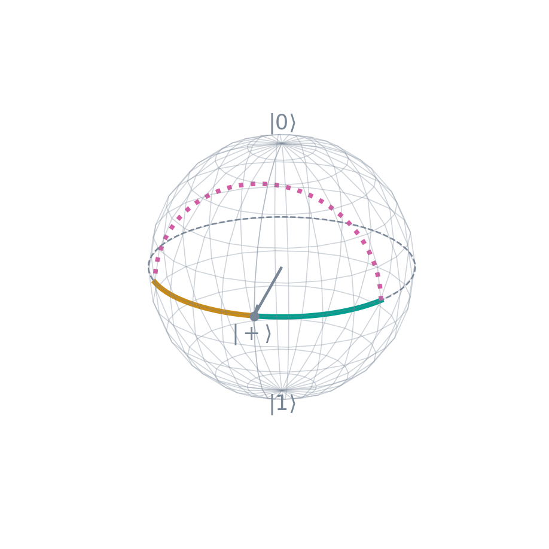

# Qubit Decoupling



*Hahn echo under constant detuning: teal shows phase drift, dotted pink illustrates the π pulse about the x axis, and amber shows refocusing.*

Qubit Decoupling is a small Python library in development for studying how control pulse timing affects coherence in a single qubit.

## Physical model

The qubit experiences a fluctuating frequency shift along the z axis. The model assumes pure dephasing and ideal, instantaneous π pulses. It excludes energy relaxation, pulse imperfections, and interactions between qubits.

## Planned protocols

| Protocol | Role in the comparison |
| --- | --- |
| Free evolution | Baseline with no control pulses. |
| Hahn echo | One midpoint pulse. Under constant detuning, it cancels the accumulated phase at the end of the sequence. |
| Carr–Purcell–Meiboom–Gill (CPMG) | Evenly spaced pulses with half-length delays before the first pulse and after the last. |
| Uhrig dynamical decoupling (UDD) | Uneven pulse spacing, to be compared with CPMG at the same duration and pulse count. |

## Dependencies

With Python 3 installed, run these commands in Bash from the repository root to set up the development environment:

```bash
python3 -m venv .venv
source .venv/bin/activate
python -m pip install numpy matplotlib pytest
```

NumPy is planned for the core calculations, Matplotlib is used by the banner script and planned for the comparison plot, and pytest will run the tests. These commands install the dependencies, not the library itself. No dependencies are needed to view the banner on GitHub.

QuTiP is optional for independent checks of the qubit evolution. To add it to the same environment:

```bash
python -m pip install qutip
```

## Development milestones

1. Calculate the accumulated phase under constant detuning. Check that it grows linearly during free evolution and returns to zero at the end of a Hahn echo.
2. Add CPMG and UDD, then calculate ensemble coherence under time-dependent noise.
3. Compare all four cases using the same noise realizations. Save the numerical results and run settings so the comparison can be replotted without rerunning the simulation.

## License

Released under the MIT License. See [LICENSE](LICENSE).

**Author:** Marco  
**Last updated:** 15 November 2026  
**Status:** Early development. The simulator and tests are planned; the library is not yet installable.
